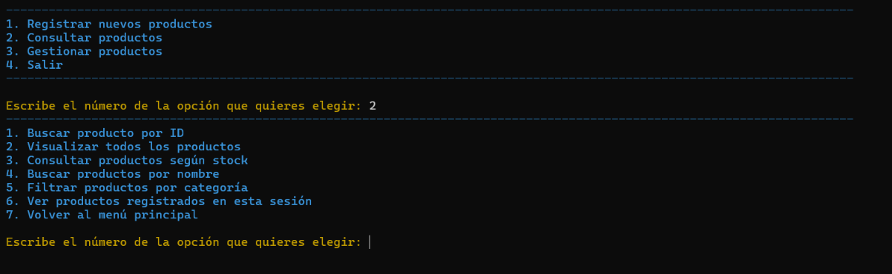
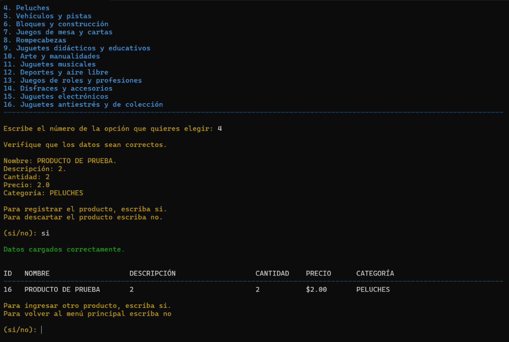
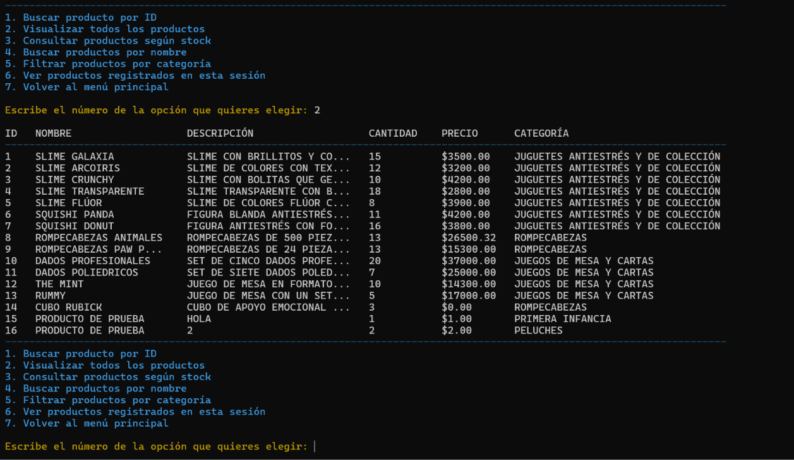
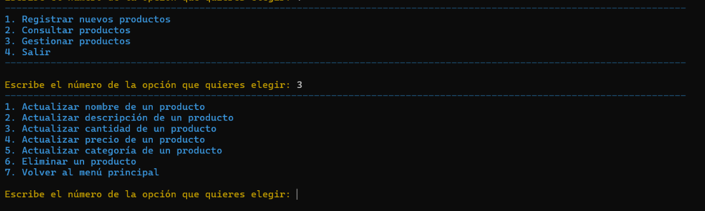
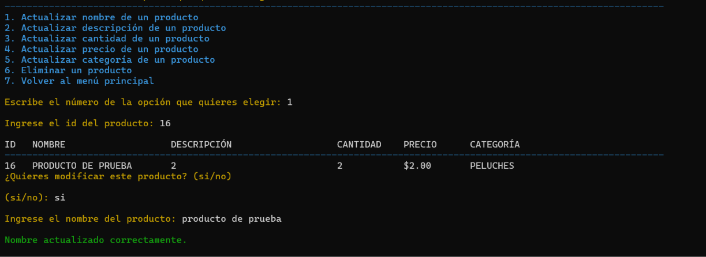
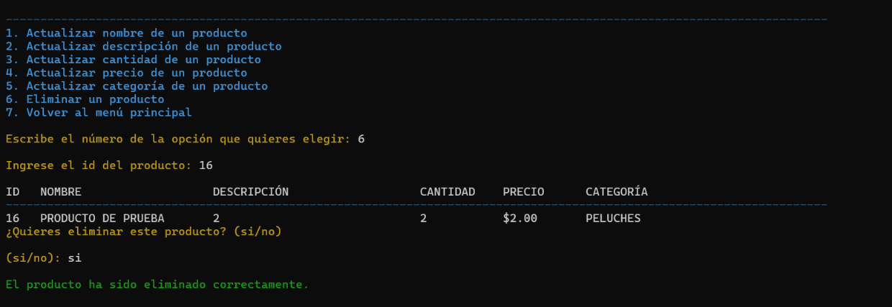

# Juguetería Casper 1.0

Aplicación desarrollada en Python para administrar el inventario de una juguetería mediante una interfaz de consola y una base de datos SQLite.

Permite registrar productos, consultar el inventario, actualizar información y eliminar registros.

## Características principales

- Registro de nuevos productos.
- Consulta y búsqueda de productos.
- Visualización del inventario completo.
- Consulta de productos según su stock.
- Búsqueda por nombre.
- Filtrado por categoría.
- Actualización de datos de productos.
- Eliminación de productos.
- Almacenamiento local y persistente del inventario.

## Descarga

Descargá la versión correspondiente a tu sistema operativo desde GitHub Releases:

**[Descargar Juguetería Casper 1.0](https://github.com/JICO001/Jugueteria-Casper/releases/latest)**

| Sistema operativo | Archivo |
|---|---|
| Windows | `JugueteriaCasper.exe` |
| Ubuntu 22.04 x86_64 | `JugueteriaCasper-ubuntu-22.04-x86_64.tar.gz` |
| macOS Intel | `JugueteriaCasper-macos-intel-x86_64.tar.gz` |

*La versión para macOS Apple Silicon no está incluida en esta publicación.*

## Instalación y ejecución

### Windows

1. Descargá `JugueteriaCasper.exe`.
2. Guardá el archivo en una carpeta de tu elección.
3. Hacé doble clic en el ejecutable para iniciar la aplicación.

No necesitás instalar Python ni SQLite.

### Ubuntu

1. Descargá el archivo `.tar.gz`.
2. Abrí una terminal en la carpeta donde descargaste el archivo.
3. Extraé su contenido:

   ```bash
   tar -xzf JugueteriaCasper-ubuntu-22.04-x86_64.tar.gz
   ```

4. Otorgá permisos de ejecución:

   ```bash
   chmod +x JugueteriaCasper
   ```

5. Iniciá la aplicación:

   ```bash
   ./JugueteriaCasper
   ```

### macOS Intel

1. Descargá el archivo `.tar.gz`.
2. Abrí una terminal en la carpeta donde descargaste el archivo.
3. Extraé su contenido:

   ```bash
   tar -xzf JugueteriaCasper-macos-intel-x86_64.tar.gz
   ```

4. Otorgá permisos de ejecución:

   ```bash
   chmod +x JugueteriaCasper
   ```

5. Iniciá la aplicación:

   ```bash
   ./JugueteriaCasper
   ```

*macOS puede mostrar advertencias de seguridad porque la aplicación no está firmada ni notarizada por Apple.*

## Uso de la aplicación

### Menú principal

Al iniciar el programa se presenta el menú principal, con cuatro opciones:

1. Registrar nuevos productos.
2. Consultar productos.
3. Gestionar productos.
4. Salir.

Para seleccionar una opción, ingresá el número correspondiente.

**Captura del menú principal:**



### Registrar nuevos productos

Esta opción permite incorporar productos al inventario.

El programa solicita los siguientes datos:

- Nombre del producto.
- Descripción (opcional).
- Cantidad de unidades.
- Precio.
- Categoría.

Los datos se validan antes de registrar el producto.

**Captura del registro de productos:**



### Consultar productos

El menú de consultas ofrece las siguientes opciones:

1. Buscar producto por ID.
2. Visualizar todos los productos.
3. Consultar productos según stock.
4. Buscar productos por nombre.
5. Filtrar productos por categoría.
6. Ver productos registrados en esta sesión.
7. Volver al menú principal.

Los resultados se muestran en una tabla con ID, nombre, descripción, cantidad, precio y categoría.

**Captura de consulta de productos:**



### Gestionar productos

Esta sección permite modificar o eliminar productos existentes.

Las opciones disponibles son:

1. Actualizar nombre de un producto.
2. Actualizar descripción de un producto.
3. Actualizar cantidad de un producto.
4. Actualizar precio de un producto.
5. Actualizar categoría de un producto.
6. Eliminar un producto.
7. Volver al menú principal.

Para realizar una modificación o eliminación, el programa solicita el ID del producto y muestra sus datos antes de continuar.

Las operaciones de modificación y eliminación requieren confirmación del usuario.

**Captura del menú de gestión:**



**Captura de actualización de un producto:**



**Captura de eliminación de un producto:**



## Actualización y conservación del inventario

Juguetería Casper almacena el inventario en un directorio local del equipo, separado de los archivos de la aplicación.

Esto permite actualizar el programa sin reemplazar la información existente.

Para actualizar la aplicación:

1. Descargá la nueva versión desde [GitHub Releases](https://github.com/JICO001/Jugueteria-Casper/releases/latest).
2. Reemplazá el ejecutable anterior por el nuevo.
3. Iniciá la aplicación.

El inventario existente se conserva y no es necesario volver a cargar los productos.

Se recomienda realizar una copia de seguridad de la base de datos antes de efectuar modificaciones importantes.

## Repositorio

El código fuente y las versiones publicadas están disponibles en:

[GitHub - Juguetería Casper](https://github.com/JICO001/Jugueteria-Casper)

**Juguetería Casper 1.0**
